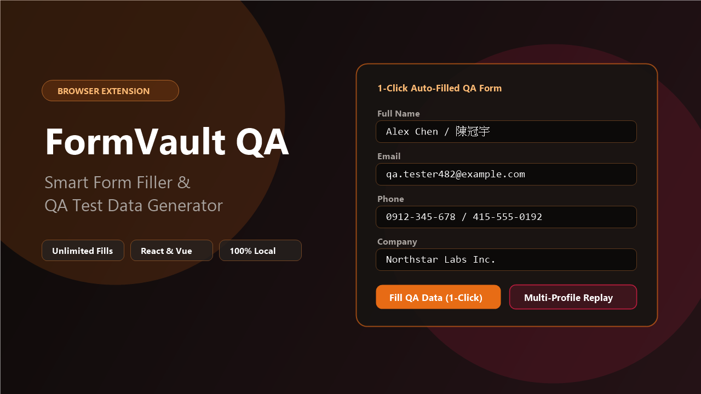

  
  <h1>FormVault QA — Smart Form Filler &amp; Test Data Generator</h1>
  
<strong>無每日上限、100% 本地端、支援 React / Vue / Angular 的多身分表單自動填寫＋一鍵 QA 測試假資料生成器（Lightning Autofill 零訂閱替代品）</strong>

  
Save &amp; autofill unlimited web forms across React/Vue/Angular apps with multi-profiles and 1-click Global / Taiwan (zh-TW) / Edge-Case QA dummy data — 100% local, zero daily limits.

  

    <a href="https://eggcellent20.gumroad.com/l/enrwux"><strong>Get FormVault QA Pro ($12 Lifetime)</strong></a> ·
    <a href="https://egg9372000.github.io/formvault/"><strong>Website</strong></a> ·
    <a href="https://egg9372000.github.io/formvault/privacy.html"><strong>Privacy Policy</strong></a>
  

  

---

> 🌐 **Language / 語言切換**：[繁體中文](#繁體中文介紹) | [English](#english-overview)

---

## 繁體中文介紹

### 為什麼做 FormVault QA？

知名填表外掛（如 Lightning Autofill）將免費版鎖死為「每天僅能填寫 10 次」並強推月費訂閱；同時許多舊款填表工具在 React、Vue、Angular 等現代前端框架上填入數值後不會觸發狀態更新。

**FormVault QA** 專為前端工程師、QA 測試人員、行政與大量填表上班族打造：
- **零每日次數上限**：免費版即可每天無限次重播填寫，絕不跳出每日額度限制。
- **原生支援 React / Vue / Angular 受控表單**：採用原生原型值設定器與完整事件派發，確保現代網頁表單正確寫入狀態。
- **一鍵填入逼真 QA 測試假資料**：免事前設定，自動辨識姓名、Email、手機、公司、地址、統編、下拉選單與勾選框；Pro 版內建 **台灣在地格式（zh-TW 姓名／09xx 手機／台北市地址／8 碼統編）** 與 **極端邊界壓力字串（Unicode／引號／符號）**。
- **絕對隱私安全**：明確跳過所有 `type="password"` 密碼欄位，全程 100% 本機執行不上傳雲端。

### 免費版 vs. Pro 買斷版

| 功能 | 免費版（Free） | Pro 終身買斷版（$12 一次性） |
|---|:---:|:---:|
| 無每日上限表單自動填寫（React / Vue / Angular 完整相容） | ✅ | ✅ |
| 儲存常用表單身分組（Form Profiles） | ✅（最多 3 組） | ✅ **無限組身分** |
| 一鍵 QA 假資料產生器 | ✅（US / Global） | ✅ **US + 台灣 zh-TW + 極端邊界測試** |
| JSON 備份還原與團隊共享測試組 | — | ✅ |
| 100% 本地端、忽略密碼欄位、無月費 | ✅ | ✅ |

---

## English Overview

Tired of 10-fills-a-day paywalls or legacy autofill extensions breaking on React/Vue/Angular apps?

**FormVault QA** offers **unlimited daily fills**, native controlled-input compatibility, reusable multi-field profiles, and 1-click synthetic QA test data generation (US/Global, Taiwan `zh-TW`, and Unicode edge-case stress strings) — 100% locally in your browser with password-field protection and zero monthly fees. Read our [Privacy Policy](https://egg9372000.github.io/formvault/privacy.html).
